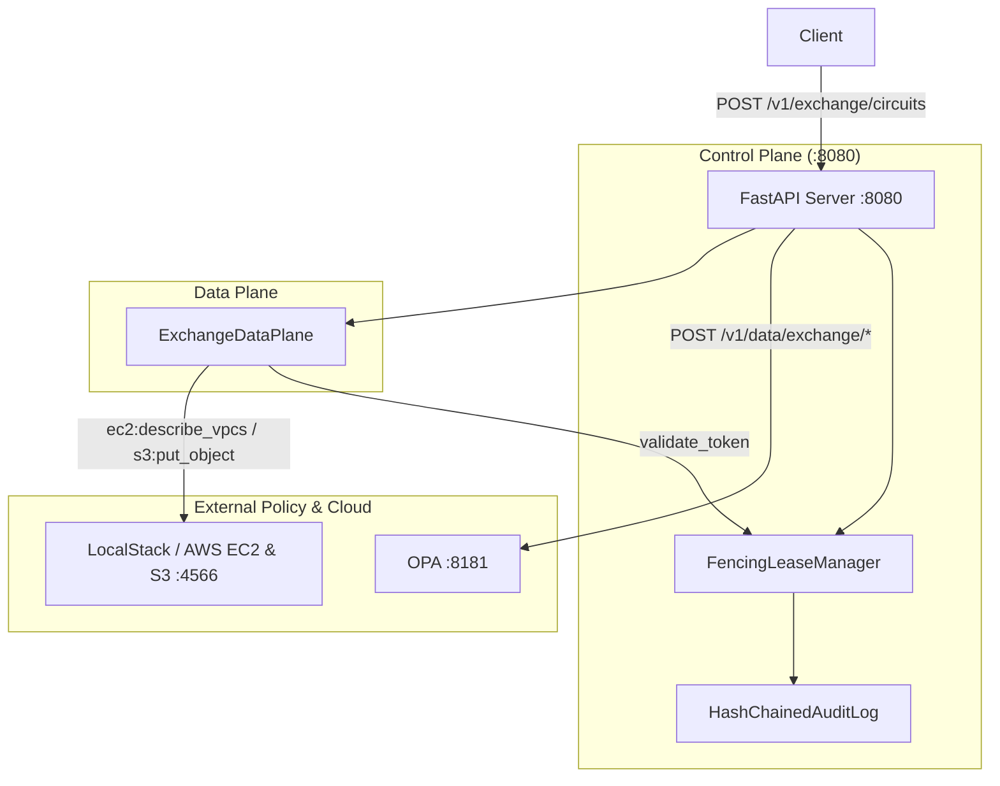
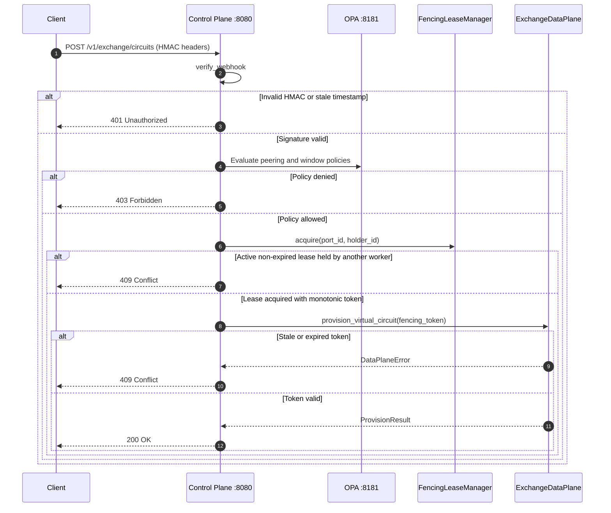
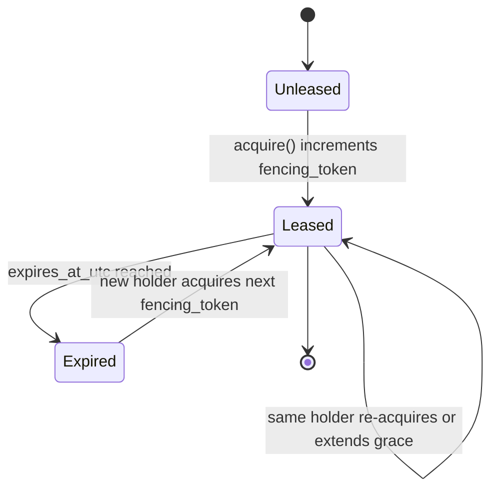

# Design Notes: Cloud Exchange Control Plane

This service separates lease and audit coordination (`controlplane/lease_manager.py`, `storage/audit_chain.py`, `controlplane/server.py`) from virtual circuit execution (`dataplane/provisioner.py`) over AWS EC2 and S3 with Open Policy Agent (OPA) policy checks.

## Control vs. Data Plane Topology

## Lease Handover and Fencing Sequence

## Lease State Lifecycle

## Trade-Offs and Limitations

All lease expirations and UTC window checks evaluate in UTC timestamps rather than local wall-clock time so Daylight Saving Time changes do not alter timeouts. Off-window changes allow up to a 15-minute grace extension when an active incident ID is supplied. AWS calls retry transient errors up to 4 times with per-attempt sleep capped at `2.0s`.

Limitations: `FencingLeaseManager` and `HashChainedAuditLog` live in single-process memory rather than a distributed consensus store or relational database, and `describe_vpcs` does not paginate across `NextToken`.
